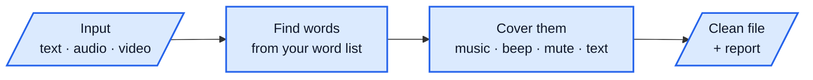
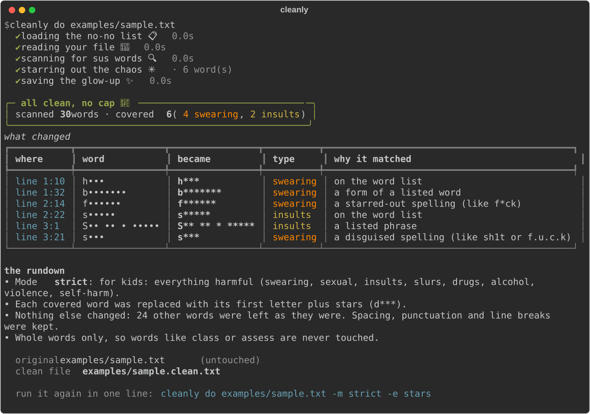

# Cleanly Censorship

**Find listed words in text, audio and video, and cover them with music, a beep or replacement text. Runs locally on your computer.**

Cleanly was started to make content safer to consume: for parents, teachers, companies and creators who want a clean version of a video, recording or document without sending it anywhere.

> 🚧 **Status: early development (v1 in progress).** Text, JSON and subtitle (.srt) censoring works now, with a guided terminal mode. Audio and video are next. The features below describe what v1 is being built to do.

---

## Example

```
Original:  "What the [bad word] was that?"
Cleaned:   "What the ♪ ♪ ♪ was that?"
```

---

## Features (v1 goals)

- **Three input types:** text (`.txt`, `.json`, `.srt`), audio and video
- **Several ways to cover a word:** music clip, beep, mute, lowered volume (duck), reversed audio, or `***` / replacement text
- **Three modes:** Strict (kids), Standard (adults) and Customize (start from either, add or remove words)
- **Guided mode:** `cleanly start` asks you everything step by step, then explains every change
- **Three security layers:** word list and ML model always run; an AI second opinion is optional (local or your own API key)
- **Review before export:** see every word that was found, with a 2-second preview, and uncover any false matches
- **Private by design:** no sign-up, no upload; everything runs on your computer

---

## How it works



The detailed flow, including which parts work today, is in [docs/ALGORITHM.md](docs/ALGORITHM.md#flow-diagram).

1. **Get the words.** Text is read directly. For audio and video, speech is transcribed with word-level timestamps.
2. **Separate (optional).** If there's background music, the voice is separated from it first, which makes transcription more accurate.
3. **Match.** Words are compared against your chosen word list.
4. **Censor.** Each matched word's time window is covered by the chosen effect.
5. **Reassemble.** Only the censored windows are rebuilt. The rest of the file stays as original quality, joined with short crossfades.
6. **Output.** You get the cleaned file plus a report of what was covered.

---

## Modes

| Mode | For | What gets covered |
|---|---|---|
| **Strict** | Kids | Everything harmful: swearing, sexual words, insults, slurs, harassment, drugs, alcohol, violence and weapons, self-harm terms |
| **Standard** | Adults | Swearing, sexual words, slurs, harassment and drug names. Kid-only words like *stupid*, *beer* or *kill* pass. |
| **Customize** | Anyone | Pick Strict or Standard as a starting point, then let words through and add your own |

```
Customize list = (Strict or Standard − words you let through) + your own words
```

Every built-in word has a **category** (swearing, sexual, insults, slurs, harassment, drugs, alcohol, violence, self-harm) and a **level**: `standard` words are covered in both modes, `strict` words only in Strict. The list is plain JSON in [`src/cleanly/data/standard_en.json`](src/cleanly/data/standard_en.json).

Customize settings can be saved and are offered again next time. They live in `~/.config/cleanly/my_list.json` (Windows: `%APPDATA%\cleanly\my_list.json`) and can be shared, for example between teachers.

---

## Security layers

Every file passes through layers, like defense in depth. Each layer covers the others' weak spots and may only do what it's trusted to do.

| Layer | Always on? | What it does | May un-cover? |
|---|---|---|---|
| **1 · Word list** | yes | Finds exact listed words, variants and disguises (`f*ck`, `sh1t`) | – |
| **2 · ML model** | yes | Scores every other sentence for insults, threats, hate and obscenity, even with no listed word. Strict mode covers them; other modes list them for review. | never |
| **3 · AI judge** | **optional** | Checks context ("kill" in *kill time* is harmless) and spots missed harm | only context words (violence, drugs, alcohol, mild insults), **never** slurs, sexual words, harassment, self-harm or your own words |

**Layer 2** uses [MiniLMv2-toxic-jigsaw](https://huggingface.co/minuva/MiniLMv2-toxic-jigsaw-onnx) (Apache-2.0, ~23 MB, runs on any CPU). It's downloaded once by the installer, pinned to an exact version and checked against a fingerprint before it's used. `cleanly models` shows its status; `cleanly models verify` re-checks it.

**Layer 3** is off unless you turn it on, in guided mode or with `--ai`:

| Option | Privacy | Setup |
|---|---|---|
| `--ai ollama` | fully local and offline | install [Ollama](https://ollama.com), then `ollama pull llama3.2:3b` |
| `--ai anthropic` | sends short text snippets to Claude | `export ANTHROPIC_API_KEY=...` |
| `--ai openai` | sends short text snippets to OpenAI or any compatible API (`--ai-url`) | `export OPENAI_API_KEY=...` |

Only the text around flagged items is sent, never your whole file and never audio or video. Keys are read from environment variables (or a hidden prompt) and are never stored or printed. The content being cleaned is treated as untrusted: it's sent as data, never as instructions, and the AI's answer must be strict JSON. If the AI is unreachable or misbehaves, Cleanly carries on with layers 1 and 2. Details in [docs/ALGORITHM.md](docs/ALGORITHM.md#1b-security-layers).

---

## Privacy

- **No sign-up, no account**
- **No upload:** works offline after the first setup (the ML model is downloaded once). The only exception is the optional cloud AI layer, which you turn on yourself.
- **No history:** temporary files, separated audio and transcripts are deleted after export

## Limitations

Speech recognition is not perfect. Accents, fast speech and loud background music can cause missed or wrong matches. Cleanly **reduces** bad language; it does not guarantee its removal. **Always review the result before sharing it**, especially for children's content.

---

## Tech stack

| Part | Tool |
|---|---|
| Language | Python 3.11 / 3.12 |
| Speech-to-text | [faster-whisper](https://github.com/SYSTRAN/faster-whisper) (English models) |
| Voice separation | [Demucs](https://github.com/facebookresearch/demucs) |
| Audio processing | numpy, soundfile |
| Video | [FFmpeg](https://ffmpeg.org/) |
| ML (layer 2) | [ONNX Runtime](https://onnxruntime.ai), [tokenizers](https://github.com/huggingface/tokenizers), MiniLMv2-toxic-jigsaw |
| AI (layer 3, optional) | [Ollama](https://ollama.com), Claude API, OpenAI-compatible APIs (standard library HTTP, no SDKs) |
| Terminal UI | [rich](https://github.com/Textualize/rich), [questionary](https://github.com/tmbo/questionary) |
| Local web UI | Gradio / FastAPI |

---

## Roadmap

### v1: English
- [x] Text censoring with the built-in list (JSON, categories and levels): `.txt`, `.json`, `.srt`
- [x] Strict / Standard / Customize modes
- [x] Guided terminal mode with live progress and explained results
- [x] One-command installers, `cleanly update` and `cleanly uninstall`
- [x] Security layers: word list + ML model (always), AI judge (optional), hardened against prompt injection
- [ ] Basic audio beep from a command line tool
- [ ] Word timestamps, music clips, stitching with crossfades
- [ ] Video support and voice separation
- [ ] Local web UI: word-list editor and review screen
- [ ] Desktop package (if people find it useful)

### v2: ideas
- [ ] More languages (Hindi / Hinglish, Gujarati and others)
- [ ] Train our own ML model for layer 2, including Hinglish and Gujarati
- [ ] Censor subtitles and on-screen text
- [ ] Real-time mode

---

## Install

One command installs everything Cleanly needs: Python 3.10+ and FFmpeg if they're missing, then Cleanly itself in its own private environment, plus the `cleanly` command.

**Windows** (PowerShell):
```powershell
irm https://raw.githubusercontent.com/damasiyachiranj/cleanly-censorship/main/install.ps1 | iex
```

**Linux** (Debian / Ubuntu / Kali, Fedora, Arch, openSUSE):
```bash
curl -fsSL https://raw.githubusercontent.com/damasiyachiranj/cleanly-censorship/main/install.sh | bash
```

Run the same command again to update. To remove Cleanly, add `-Uninstall` on Windows or `--uninstall` on Linux. Python and FFmpeg stay installed.

| | Windows | Linux |
|---|---|---|
| Installs to | `%LOCALAPPDATA%\cleanly-censorship` | `~/.local/share/cleanly-censorship` |
| Missing software from | `winget` | `apt` / `dnf` / `pacman` / `zypper` (asks for sudo) |
| Skip FFmpeg (text only) | `-NoFfmpeg` | `--no-ffmpeg` |

> **Prefer to check before running?** Good habit. Download the script, read it, then run it:
> `curl -fsSLO https://raw.githubusercontent.com/damasiyachiranj/cleanly-censorship/main/install.sh && less install.sh && bash install.sh`
> (Windows: open the `install.ps1` link in a browser, save it, read it, then run `.\install.ps1`.)

### Manual install (developers)

```bash
git clone https://github.com/damasiyachiranj/cleanly-censorship.git
cd cleanly-censorship
python -m venv .venv
# Windows: .venv\Scripts\activate    Linux: source .venv/bin/activate
pip install -e ".[dev]"
```

## Use it

**Easiest:** the guided mode asks you everything, one question at a time:

```bash
cleanly start
```

Pick a language, drop in your file, choose a mode and how words get covered. Cleanly shows its progress live and ends with a table of every change and why it was made.



**One-liners:**

```bash
cleanly do notes.txt                                   # Strict mode, d*** style
cleanly do subs.srt -m standard -e symbol              # adults list, ♪ instead of words
cleanly do chat.json -m customize --base standard --add frick --remove hell
cleanly do notes.txt -e replace --replacement beep -r report.json
```

| Option | Values |
|---|---|
| `-m`, `--mode` | `strict` (default, kids), `standard` (adults), `customize` |
| `--base` | for customize: start from `strict` or `standard` |
| `--add` / `--remove` | for customize: comma-separated words (or `--list my_list.json`) |
| `-e`, `--effect` | `stars` → `d***` (default), `full` → `****`, `symbol` → `♪`, `replace` → your word |
| `-o`, `--output` | where to save (default: `name.clean.ext`, the original is never changed) |
| `-r`, `--report` | save a JSON report of every change (words shown masked) |
| `--ai` | optional layer 3: `ollama` (local), `anthropic`, `openai`; with `--ai-model`, `--ai-url` |
| `--ml-threshold` | how sure layer 2 must be before flagging (0–1, default 0.8) |
| `--plain` / `--fast` / `-q` | serious tone / no animations / one-line output |

**Housekeeping:** `cleanly update`, `cleanly uninstall`, `cleanly models`, `cleanly help`, `cleanly version`.

Run the tests with `pip install -e ".[dev]"` and `pytest`.

### Planned (audio and video)

```bash
cleanly do video.mp4 -m strict -e music
```

The step-by-step algorithms are in [docs/ALGORITHM.md](docs/ALGORITHM.md).

---

## Contributing

Contributions are welcome, especially to the word lists. Open an issue or a pull request to suggest words, variants, categories or level changes.

## License

[MIT](LICENSE). Third-party word lists or models included in this project keep their own licenses and are credited here.

## Author

Built by [@damasiyachiranj](https://github.com/damasiyachiranj).
