# Cleanly: Algorithms

This document describes every decision Cleanly makes, step by step. Code follows these algorithms; if the two disagree, the code is wrong.

Cleanly uses AI models only as "senses":

- **Whisper** turns speech into words with timestamps
- **Demucs** separates a voice from background music

Every *decision* (what gets censored, where, and how) is made by the plain algorithms below. That keeps the tool predictable and explainable: for any censored word you can say exactly which list entry, category and mode caused it.

---

## Flow diagram

```mermaid
flowchart LR
    IN[/"Input file<br/>.txt · .json · .srt · audio · video"/]

    subgraph LIST["Build the word list"]
        direction TB
        STD["Built-in list<br/>category + level"] --> MODE("Mode<br/>strict · standard · customize")
        USER["Customize<br/>base + let through / add"] --> MODE
        MODE --> FINAL["Final list"]
    end

    IN --> TYPE{"File type?"}

    TYPE -->|"text / JSON / SRT"| READ["Read words<br/>with positions"]
    TYPE -->|"audio / video"| EXTRACT["Extract audio<br/>FFmpeg"]
    EXTRACT --> SEP["Separate voice and background<br/>Demucs, optional"]
    SEP --> ASR["Transcribe the voice<br/>word timestamps, Whisper"]

    READ --> MATCH
    ASR --> MATCH
    FINAL --> MATCH["Find words<br/>whole words · phrases · disguises like f*ck"]

    MATCH --> REVIEW["Review<br/>uncover false matches"]

    REVIEW -->|text| TEXTFX["Replace text<br/>d*** · **** · ♪ · your word"]
    REVIEW -->|"audio / video"| AUDIOFX["Cover each word<br/>music · beep · mute · duck · reverse"]
    AUDIOFX --> STITCH["Stitch into the original<br/>20 ms crossfades"]
    STITCH -->|video| REMUX["Put audio back into video<br/>no re-encode"]

    TEXTFX --> OUT[/"Clean file + report"/]
    STITCH -->|audio| OUT
    REMUX --> OUT

    classDef done fill:#dbeafe,stroke:#2563eb,stroke-width:2px,color:#0f172a
    classDef planned fill:#fff7ed,stroke:#ea580c,stroke-dasharray:6 4,color:#7c2d12
    class IN,TYPE,READ,STD,USER,MODE,FINAL,MATCH,TEXTFX,OUT done
    style LIST fill:#f8fafc,stroke:#94a3b8
    class EXTRACT,SEP,ASR,REVIEW,AUDIOFX,STITCH,REMUX planned
```



**Solid blue**: works now (v0.1) · **Dashed orange**: coming in v1

---

## 0. Data model

**Word list entry**
```json
{ "word": "damn", "variants": ["damned", "dammit"], "category": "swearing", "level": "strict" }
```
- `word`: the main form. It may be a phrase of several words.
- `variants`: other spellings and forms that mean the same thing.
- `category`: swearing, sexual, insults, slurs, harassment, drugs, alcohol, violence or self-harm.
- `level`: `standard` (covered in Standard and Strict mode) or `strict` (Strict mode only).

**Token**: one word found in the input.
```
Token = { text, start, end }
```
`start`/`end` are character offsets for text, or seconds for audio.

**Match**: one span to censor.
```
Match = { start, end, text, entry, how }    # how: exact | variant | disguised | wildcard | phrase
```

---

## 1. Build the final word list

```
ALGORITHM BuildList(builtin, mode, user)
  INPUT  builtin : list of entries (built-in)
         mode    : "strict" | "standard" | "customize"
         user    : { base: "strict"|"standard", remove: [words], add: [entries] }

  Pick(level_mode):
      if level_mode = "strict":   return builtin                       # everything
      if level_mode = "standard": return [ e in builtin where e.level = "standard" ]

  if mode = "strict" or mode = "standard":
      return Pick(mode)

  # customize
  base ← Pick(user.base)
  base ← [ e in base where e.word ∉ user.remove ]          # remove a word → all its forms pass
  for each e in base:
      e.variants ← [ v in e.variants where v ∉ user.remove ]  # remove one form → only that form passes
  return base + user.add
```

| Mode | Who for | Words |
|---|---|---|
| Strict | kids | every entry |
| Standard | adults | entries with level `standard` |
| Customize | anyone | Strict or Standard, minus what you let through, plus your words |

Words a user adds are always covered.

---

## 2. Normalize a word

Used on both list entries and input tokens, so the two compare fairly.

```
ALGORITHM Normalize(w)
  1. w ← lowercase(w)
  2. replace look-alike characters:
        @→a  4→a  $→s  5→s  0→o  1→i  !→i  3→e  7→t
  3. remove separators inside the word:  .  -  _
        ("f.u.c.k" → "fuck")
  4. strip leading/trailing apostrophes
  5. return w
```

A `*` inside a token is kept: it is treated as a wildcard in step 3 (`f*ck`).

---

## 3. Find words to censor (the matcher)

```
ALGORITHM FindMatches(tokens, entries)
  PREPARE (once per list)
    singles ← hash map: Normalize(form) → entry      for every one-word form
    phrases ← list of (normalized word sequence, entry), longest first
    wild    ← singles grouped by length               for wildcard tokens

  matches ← [ ]
  i ← 0
  while i < length(tokens):
      # 1. phrases first, so "son of a b..." is one match, not two
      for each (seq, entry) in phrases:
          if Normalize(tokens[i .. i+len(seq)-1]) = seq:
              add Match(tokens[i].start, tokens[i+len(seq)-1].end, entry)
              i ← i + len(seq); continue outer loop

      t ← Normalize(tokens[i].text)

      # 2. exact lookup, O(1)
      if t ∈ singles:
          add Match(tokens[i], singles[t]);  i ← i + 1; continue

      # 3. wildcard: "f*ck" matches any listed word of the same length
      #    whose letters agree wherever the token is not '*'
      if '*' ∈ t and t has at least one real letter:
          for each form f in wild[length(t)]:
              if all positions agree (or token has '*'):
                  add Match(tokens[i], entry of f); break

      i ← i + 1
  return matches
```

**Why whole tokens?** Matching whole words, never substrings, avoids the "Scunthorpe problem": `class`, `assess` and `Scunthorpe` are never touched. Every real form a word can take is listed in its `variants`.

Complexity: O(n) for n tokens with a constant number of phrases. The wildcard case is rare.

---

## 4. Censor text

```
ALGORITHM CensorText(text, matches, effect)
  process matches from LAST to FIRST, so earlier offsets stay valid:
      original ← text[m.start : m.end]
      new ← effect(original)
      text ← text[0 : m.start] + new + text[m.end : ]
  return text
```

Effects:

| Effect | `damn` becomes | Rule |
|---|---|---|
| `stars` | `d***` | keep the first letter, `*` for each other letter |
| `full` | `****` | `*` for every letter, spaces kept |
| `symbol` | `♪` | one music note |
| `replace` | `darn` | user's word, copying the original's case (`DAMN` → `DARN`, `Damn` → `Darn`) |

### Text formats
- **.txt**: the whole file is the text.
- **.json**: walk the structure recursively; censor **string values only**. Keys, numbers and booleans are never touched, so the file stays valid.
- **.srt**: keep index lines and timestamp lines exactly; censor only the caption lines.

---

## 5. Audio: find the words (step 2 of the roadmap)

```
ALGORITHM AudioTokens(audio, separate)
  1. if separate: voice, background ← Demucs(audio)
     else:        voice ← audio; background ← none
  2. words ← Whisper(voice, word_timestamps = true, language = "en")
        each word: { text, start_sec, end_sec, confidence }
  3. return words as Tokens (start/end in seconds)
```

The same `FindMatches` from section 3 runs on these tokens.

**Confidence**: a match whose confidence is below the threshold (default 0.5) is still censored, but flagged `needs_review`, so the review screen shows it first.

---

## 6. Censor windows

```
ALGORITHM Windows(matches, pad = 0.05 s, duration)
  1. for each m: window ← [max(0, m.start − pad), min(duration, m.end + pad)]
  2. sort windows by start
  3. merge windows that overlap or are closer than 0.1 s
        (two bad words in a row get one continuous effect, not two blips)
  4. return windows
```

---

## 7. Audio effects (per window of length L seconds)

| Effect | Output for the window |
|---|---|
| `beep` | sine wave, 1000 Hz, loudness matched to the speech around it |
| `music` | music clip fitted to L (see below) |
| `mute` | silence on the voice; background kept if separated |
| `duck` | voice × 0.1 (−20 dB) |
| `reverse` | the voice samples of the window, reversed |

**Fitting a music clip to L**
```
if clip_length ≥ L: take the first L seconds of the clip
else:               loop the clip until it reaches L
apply 20 ms fade-in and fade-out
scale to the RMS loudness of the 1 s of speech before the window
```

---

## 8. Stitch it back together

Only censored windows are rebuilt. The rest of the file stays as original samples, since separation adds small artifacts.

```
ALGORITHM Stitch(original, background, windows, effect)
  out ← copy of original
  for each window w = [a, b]:
      bed     ← background[a:b]  if background exists, else silence
      piece   ← bed + effect(window)          (mixed sample-by-sample)
      out[a:b] ← crossfade(out, piece, 20 ms at both edges)
  return out
```

**Crossfade** over n samples: `out[i] = old[i] × (1 − i/n) + new[i] × (i/n)`. This hides clicks at the edges.

---

## 9. Video

```
1. ffmpeg: extract audio track → WAV
2. run sections 5–8 on the WAV
3. ffmpeg: replace the audio track with the cleaned WAV, copy the video stream
   unchanged (no re-encode): -map 0:v -map 1:a -c:v copy
```

---

## 10. Report

Every run can write a report of what was covered:
```json
{ "start": 12.40, "end": 12.91, "category": "swearing", "why": "disguised",
  "rule": "standard", "masked": "f***", "needs_review": false }
```
The report shows the masked form (`f***`), never the full word, so it is safe to show in kids mode.
